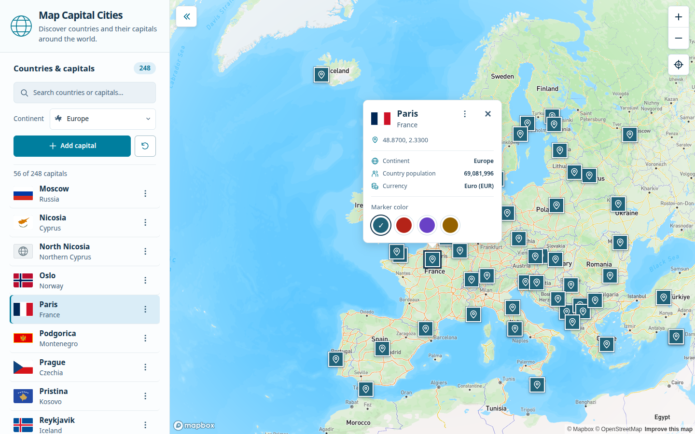
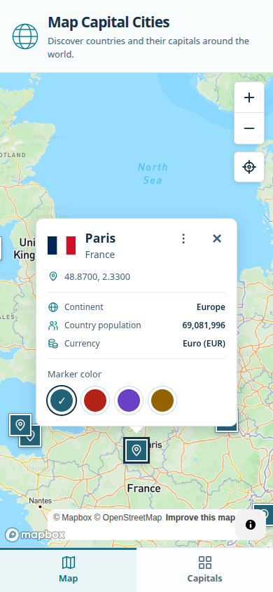
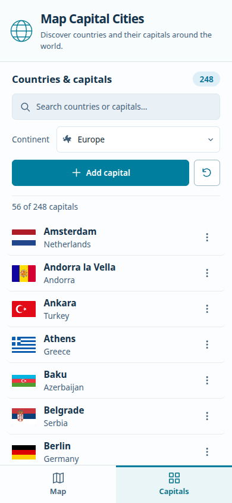

<p align="right">
  <sub>Full-Stack Take-Home Project</sub><br>
  <a href="https://github.com/JonasGreim/Map-Capital-Cities/actions/workflows/ci.yml?query=branch%3Amain"></a>
</p>

<p align="center">
  
</p>

# Map Capital Cities

## Project Overview

Explore and manage capital cities on an interactive world map, with PostgreSQL-backed
CRUD and country information imported from REST Countries v5.

- Interactive Mapbox world map with square 32 × 32px markers and a linked capital/country list.
- Create, edit and delete capitals; pick coordinates on the map or restore the default dataset.
- Search the list by capital or country; filter both the list and map by continent.
- Country flags and popup facts: continent, country population and currencies.
- Four marker colors, saved in the current browser across reloads.
- Desktop sidebar and responsive mobile **Map / Capitals** bottom navigation.

### Tech Stack

- **Frontend:** React 18, TypeScript, Vite 5, Zustand 4, plain CSS.
- **Backend:** Node.js 24, Fastify 5.
- **Database:** PostgreSQL 16.
- **Maps & Data:** Mapbox GL JS 3, REST Countries v5.
- **Infrastructure:** npm workspaces, Docker Compose, Nginx.
- **Testing & Quality:** Node test runner / tsx, ESLint, TypeScript, GitHub Actions.

## Table of Contents

1. [Screenshots](#screenshots)
2. [Getting Started](#getting-started)
3. [Development](#development)
4. [Architecture](#architecture)
5. [Testing](#testing)
6. [Documentation](#documentation)

## Screenshots

<!-- TODO: Add docs/images/desktop.png, then remove this comment wrapper.

-->

<!-- TODO: Add both mobile images, then remove this comment wrapper.
<p>
  
  
</p>
-->

Final desktop and mobile screenshots will be added here.

## Getting Started

Use **Docker with Docker Compose**, a [REST Countries API key](https://restcountries.com)
and a [public Mapbox token](https://account.mapbox.com); no host Node/npm is required.
From the repository root, create `.env` once:

```bash
cp .env.example .env
```

Set `RESTCOUNTRIES_API_KEY` (private, backend only) and `VITE_MAPBOX_TOKEN` (public,
used at frontend build time). Keep `.env` local, then start:

```bash
docker compose -f compose.full.yaml up --build -d
```

Open <http://localhost:8080>. Frontend, API and PostgreSQL start together; the demo
database uses a separate persistent volume from development, retained when stopped.

```bash
docker compose -f compose.full.yaml down
```

See [Docker details](docs/development.md#optional-full-stack-docker-demo) for ports, health checks and volumes.

## Development

For hot reload, use **Node.js 24.22.1**, **npm 11.19.1** and Docker for PostgreSQL.
Use the same configured `.env` from [Getting Started](#getting-started);
[.env.example](.env.example) includes the local database URL and default API port.

```bash
npm ci
npm run db
npm run dev
```

Frontend: <http://localhost:5173> · API: <http://localhost:3001> · [DB health](http://localhost:3001/health).
The backend waits for PostgreSQL and completes its import before listening, so Vite
may be ready first. See [development and troubleshooting](docs/development.md).

## Architecture

```text
React + Vite + Zustand ──► Fastify REST API ──► PostgreSQL
        │                        ▲
        ▼                        │ startup import
     Mapbox                REST Countries v5
```

CRUD and reset have no authentication; use disposable demo data. Backend restarts
can restore deleted imported capitals; see [reset and persistence limits](docs/technical-reference.md#reset-to-default).

## Testing

```bash
npm run check
npm test
```

`check` runs ESLint, TypeScript and both builds; `test` runs backend and frontend tests.
GitHub Actions runs these checks on PRs and pushes to `main`.
Additional isolated PostgreSQL and local Chromium tests are described in [Testing](docs/testing.md); Chromium is not part of CI.

## Documentation

- [Technical Reference](docs/technical-reference.md): API, import, schema, reset/security and UI behavior.
- [Development](docs/development.md): configuration, Docker operation and troubleshooting.
- [Testing](docs/testing.md): unit, PostgreSQL, browser tests and coverage status.
- [Submission / Validation](docs/submission.md): readiness checklist, preserved documentation and validation reports.
